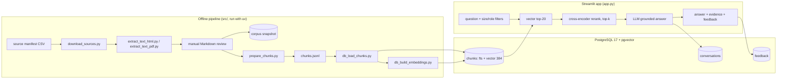

# AUS AI Security Navigator

A retrieval-augmented generation (RAG) assistant for official Australian Cyber Security Centre (ACSC) guidance on securing artificial intelligence. A user asks a question, optionally narrows it by organisation size and AI role, and gets an answer built only from retrieved ACSC passages, with the source chunks shown alongside it.

The project covers the whole path: sourcing and cleaning documents, audience-aware chunking, a PostgreSQL/pgvector index, four retrieval strategies compared on a synthetic benchmark, LLM answer generation and judging, and a Streamlit app with conversation logging and a monitoring dashboard. It is maintained as a portfolio piece and a base for further experiments.

**Status:** working prototype. It runs end to end locally and under Docker Compose. It has no automated test suite, no authentication, and has been evaluated only on a small synthetic benchmark. See [Limitations](#limitations-and-known-issues).

## Problem

ACSC publishes AI security advice across several web pages and PDFs, written for different audiences (small business, medium business, large enterprise/government/critical infrastructure, and people who use or build AI systems). Finding the passage that applies to a particular organisation is slow, and a general-purpose LLM may answer without citing or matching the ACSC guidance.

This project indexes a curated set of ACSC documents with audience metadata, so retrieval can be filtered by who the guidance is for, and so each answer can be traced back to specific source chunks.

## What it does

- **Corpus:** 10 core ACSC documents (7 HTML pages, 3 PDFs), listed with provenance and audience tags in [`data/source_manifest_core.csv`](data/source_manifest_core.csv). Five further documents are recorded in [`data/source_manifest_boundary.csv`](data/source_manifest_boundary.csv) but not indexed.
- **Chunking:** heading-aware chunking of the reviewed Markdown produces 350 chunks (`chunking_version` `v1`) in [`data/chunks/chunks.jsonl`](data/chunks/chunks.jsonl). Each chunk carries its heading path, document title, a size audience tag and role audience tags.
- **Retrieval:** four backends over the same PostgreSQL table: full-text (`ts_rank`), vector (MiniLM embeddings, pgvector cosine distance), vector plus cross-encoder reranking, and hybrid (reciprocal rank fusion of text and vector). An optional LLM query-rewrite helper exists but is not used by default.
- **Answering:** the retrieved chunks go to an LLM with a prompt that requires grounded answers. The model returns the answer, a `grounded` flag and the chunk IDs it used. The app discards claimed IDs that were not retrieved, and replaces the answer with "I don't know based on the retrieved context." if it claims grounding but cites no valid chunk.
- **App:** Streamlit UI with an AI Navigator tab (filters, top-k slider, answer, per-chunk evidence panel, thumbs up/down) and a Monitoring Dashboard tab.
- **Monitoring:** every question is logged to PostgreSQL (`conversations`) with latency, token counts and estimated cost; feedback goes to `feedback`. The dashboard has summary metrics, seven charts and a recent-conversations table.
- **Evaluation:** a 27-question synthetic benchmark with known gold chunks, retrieval metrics (Hit@k, MRR), and LLM-as-judge scoring of generated answers.

## Architecture



| Layer | Technology |
|---|---|
| Language / tooling | Python 3.13, `uv` (lockfile committed) |
| Storage and search | PostgreSQL 17 with `pgvector` (`pgvector/pgvector:pg17` image), `tsvector` full-text search, `psycopg` 3 |
| Embeddings | `sentence-transformers/all-MiniLM-L6-v2` (384 dimensions, normalised) over title, heading breadcrumb and chunk text |
| Reranker | `cross-encoder/ms-marco-MiniLM-L-6-v2` over the top 20 vector candidates |
| LLM access | OpenAI Python SDK against a configurable OpenAI-compatible endpoint; `.env.example` targets Gemini (`gemini-3.1-flash-lite`). Structured output via Pydantic. |
| Extraction | `requests`, BeautifulSoup/`lxml` (HTML), `pypdf` (PDF) |
| UI | Streamlit, Plotly, pandas |
| Runtime | Docker, Docker Compose (`postgres`, one-off `bootstrap`, `app`) |

Embedding and reranker models run locally on CPU. Only answer generation, judging, question generation and query rewriting call an external LLM.

## Evaluation results

All numbers are on the same 27 synthetic questions that were used to choose the defaults, so they are comparative evidence, not an estimate of real-world accuracy.

**Benchmark construction.** 27 hand-picked seed passages (spanning all three organisation sizes and both roles) are matched to concrete chunks by a deterministic scoring script. An LLM then writes one user-style question per passage. See [`docs/evaluation-notes.md`](docs/evaluation-notes.md) and [`docs/dataset-notes.md`](docs/dataset-notes.md).

**Retrieval** (strict = exact gold `chunk_id` in top 5; relaxed = same source and leaf heading in top 10). Recomputed from the committed [`data/eval/retrieval_debug.jsonl`](data/eval/retrieval_debug.jsonl):

| Backend | Strict Hit@5 | Strict MRR | Relaxed Hit@10 | Relaxed MRR |
|---|---:|---:|---:|---:|
| Text (full-text search) | 0.259 | 0.099 | 0.259 | 0.099 |
| Hybrid (RRF) | 0.778 | 0.373 | 0.889 | 0.389 |
| Vector | 0.852 | 0.750 | 0.926 | 0.761 |
| **Vector + rerank (default)** | **0.926** | **0.889** | **0.963** | **0.894** |

Query rewriting by an LLM did not improve the best backend (vector + rerank: strict MRR 0.889 without rewriting, 0.818 with), so it is not in the default path.

**Answer quality** (LLM judge, `good`/`bad`, from the committed judged files):

| Answer set | Retrieval | Prompt | `good` |
|---|---|---|---:|
| `answers_vector_v1_judged.jsonl` | vector | v1 | 22/27 |
| `answers_vector_v2_judged.jsonl` | vector | v2 grounded | 26/27 |
| `answers_vector_reranked_v2_prompt_grounded_judged.jsonl` | vector + rerank | v2 grounded | 26/27 |

The v1 to v2 change is a prompt change. Adding reranking did not change the judged score (26/27 both ways); its benefit is visible in the retrieval metrics only. The three files were judged with different versions of the judge prompt and the generator and judge are the same model, so treat these as indicative. Details in [Limitations](#limitations-and-known-issues).

## Quick start

You need Docker with Compose, and an API key for an OpenAI-compatible LLM endpoint.

```bash
cp .env.example .env
# edit .env: set LLM_API_KEY, and check LLM_BASE_URL and MODEL_ID for your provider

docker compose up -d postgres          # PostgreSQL + pgvector
docker compose run --rm bootstrap      # create tables, load 350 chunks, build embeddings
docker compose up -d app               # Streamlit on http://localhost:8501
```

The first bootstrap and first query download the two Hugging Face models (cached in the `huggingface_cache` volume). `docker compose down -v` removes the database and model cache.

The bootstrap needs no LLM key, but Compose reads `.env`, so the file must exist.

### Local development without the app container

```bash
uv sync
docker compose up -d postgres          # or any PostgreSQL with pgvector; match DATABASE_URL
uv run python src/db_init.py
uv run python src/db_load_chunks.py
uv run python src/db_build_embeddings.py
uv run python -m streamlit run app.py
```

Try the retrieval backends from the command line:

```bash
uv run python src/retrieve_reranked.py \
  "How can a small business reduce the risk of data leakage when using AI tools?" \
  --size-tag small_business --role-tag ai_consumer --limit 5
```

The same script pattern works for `retrieve_text.py`, `retrieve_vector.py` and `retrieve_hybrid.py`.

### Re-running evaluation

```bash
uv run python src/evaluate_retrieval.py --debug-output data/eval/retrieval_debug.jsonl   # needs DB, embeddings and LLM key
uv run python src/generate_answers.py     # needs LLM key; overwrites the reranked answers file
uv run python src/judge_answers.py        # needs LLM key; overwrites the judged file
```

`evaluate_retrieval.py` always runs the four query-rewrite variants too. If the LLM call fails (for example a bad key) the run stops with the error rather than falling back to the original query. Metrics print to stdout as JSON. Rebuilding the corpus from the ACSC websites, the full pipeline order, and Docker details are in [`docs/runbook.md`](docs/runbook.md).

## Configuration

Set in `.env` (see [`.env.example`](.env.example)). `.env` is git-ignored.

| Variable | Used by | Notes |
|---|---|---|
| `DATABASE_URL` | all database scripts, app | Local default targets the Compose `postgres` service on `localhost:5432`. Compose overrides it for the `app` and `bootstrap` containers. |
| `LLM_API_KEY` | answer generation, judging, question generation, query rewriting, app | Not needed for retrieval-only scripts or bootstrap. |
| `LLM_BASE_URL` | same | Passed to the OpenAI SDK as `base_url`. |
| `MODEL_ID` | same | Required (no code default). Cost estimates exist only for models listed in [`src/pricing.py`](src/pricing.py); other models log $0.00. |

## Repository layout

```text
app.py                 Streamlit app: AI Navigator + Monitoring Dashboard
src/                   Pipeline, retrieval, evaluation and LLM scripts (flat modules, run as scripts)
  download_sources.py, extract_text_*.py, prepare_chunks.py, spotcheck_chunks.py
  db*.py               schema, chunk loading, embedding build, connection helper
  retrieve_*.py        text, vector, reranked, hybrid, rewritten retrieval
  resolve_seed_draft_ids.py, generate_ground_truth_questions.py
  generate_answers.py, judge_answers.py   current answer generation and judging
  *_v1.py, judge_answers_v2.py            earlier versions kept for provenance
  evaluate_retrieval.py, llm_client.py, pricing.py, rewrite_query.py
data/
  source_manifest_core.csv / _boundary.csv
  corpus_snapshots/    reviewed Markdown v1 with checksums (treat as immutable)
  processed/           working copy of reviewed Markdown
  chunks/              chunks.jsonl and chunk spot-check samples
  ground_truth_*.json* seed definitions, match candidates, 27 synthetic questions
  answers/             generated and judged answer sets
  eval/                per-question retrieval debug output
docs/                  runbook, evaluation notes, dataset notes, decisions, status, project log
Dockerfile, docker-compose.yml, .streamlit/config.toml, pyproject.toml, uv.lock
```

## Design decisions

The full records are in [`docs/decisions.md`](docs/decisions.md). The ones that shaped the project most:

- **Audience as metadata, not separate indexes.** Manifest-level `size_audience_tag` and `role_audience_tags` are copied onto every chunk and used as SQL filters. A size filter also returns chunks tagged `all_sizes`.
- **Manual review checkpoint plus immutable snapshot.** Extracted Markdown is hand-corrected for extraction noise, then frozen under `data/corpus_snapshots/`. Fresh downloads can differ from the reviewed corpus, so the snapshot is what makes the benchmark reproducible.
- **Heading-aware chunking.** Chunks follow document structure (enumerated items, risk/mitigation pairs, tables) rather than fixed windows, so gold passages map to meaningful units.
- **PostgreSQL for everything.** One database holds full-text search, vectors and monitoring tables, which keeps the stack small.
- **Choose defaults from measurements.** Four retrievers and two answer prompts were compared before picking vector + rerank and the v2 grounded prompt. Query rewriting was built, measured, and left out because it did not help.
- **Compose for the runtime, `uv` for the offline pipeline.** Corpus preparation and evaluation are not containerised.

## Limitations and known issues

Short list; the full backlog with evidence is in [`docs/status.md`](docs/status.md).

- **No automated tests.** `src/test_structured_output.py` is a manual connectivity check against the LLM endpoint, not a test suite. Nothing runs in CI.
- **Small, synthetic, self-selected benchmark.** 27 questions generated by an LLM from seed passages I chose, used both to compare and to choose defaults. No held-out set and no human-labelled questions.
- **Judge caveats.** Generation, question writing and judging all use the same model. Three judge prompt versions exist and the committed judged files do not record which produced them. One `bad` verdict out of 27 means a single answer separates the v2 variants from 100%.
- **Benchmark pipeline is only partly reproducible from the repo.** The LLM seed-vetting step has no committed script or output file, and the question generator reads `data/seed_chunk_candidates.json` directly.
- **Embedding model changes need a manual refresh.** `db_load_chunks.py` now clears the embedding of any chunk whose title, headings or text changed, but switching the embedding model requires `UPDATE chunks SET chunk_embedding = NULL;` before rerunning `db_build_embeddings.py`.
- **No vector index.** Nearest-neighbour search is an exact scan, which is fine for 350 chunks and would need HNSW/IVFFlat at scale.
- **Not production-ready.** The app has no authentication or rate limiting, logs user questions and answers in plain text with no retention policy, and Compose uses a fixed `postgres`/`postgres` password and publishes port 5432. A previous EC2 demo served plain HTTP.
- **Scope is narrow.** Ten documents, English only, single-turn Q&A, no conversation memory.

## Roadmap ideas

None of these are started.

- Add a test suite (retrieval filters, chunk-ID validation, cost estimate, chunking) and a CI workflow.
- Build a larger evaluation set with human-written questions and a held-out split; calibrate the judge against human labels.
- Commit the seed-vetting step as a script and make the benchmark pipeline reproducible end to end.
- Fix the embedding refresh behaviour and add a vector index if the corpus grows.
- Try gated query rewriting (only for vague queries), other embedding models, and rerank candidate-pool sizes against the existing benchmark.
- Expand the corpus with the boundary documents and add a refresh process for updated ACSC pages.
- Harden deployment: HTTPS, secrets management, auth, configurable database credentials.

## Documentation

| Document | Contents |
|---|---|
| [`docs/runbook.md`](docs/runbook.md) | Step-by-step commands for every pipeline stage, Docker runtime and deployment notes |
| [`docs/status.md`](docs/status.md) | Current state, known issues with evidence, unverified items, backlog |
| [`docs/evaluation-notes.md`](docs/evaluation-notes.md) | Benchmark construction, metrics, results, caveats |
| [`docs/dataset-notes.md`](docs/dataset-notes.md) | Corpus scope, chunk schema and chunking rules, audience model |
| [`docs/decisions.md`](docs/decisions.md) | Decision records D-001 to D-016 |
| [`docs/project-log.md`](docs/project-log.md) | Chronological build log (2026-07-21 to 2026-08-04) |

## History and demo

The project was built between 21 July and 4 August 2026; the build log is in [`docs/project-log.md`](docs/project-log.md). A short-lived EC2 instance served the Compose stack over HTTP as a demo; assume it is offline. No hosted demo is currently maintained.

## Licence and attribution

Code is released under the [MIT licence](LICENSE). The ACSC documents are published by the Australian Cyber Security Centre; the snapshot and chunks in this repository are derived from public pages for research and education, and each chunk records its source. This project is not affiliated with, sponsored by, or endorsed by the ACSC, the Australian Signals Directorate or the Australian Government. Check the ACSC's own terms before reusing its content.
